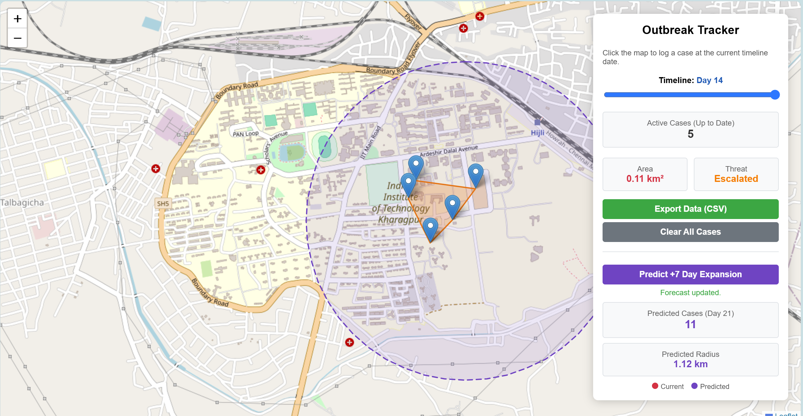

# Spatial Analytics Engine for Disease Outbreaks

**Live Demo:** [https://outbreak-spatial-mapper.vercel.app/](https://outbreak-spatial-mapper.vercel.app/)

## Project Overview

This repository contains a full-stack GIS-based web application designed to model, analyze, and forecast infectious disease outbreaks. It dynamically generates the minimum bounding area (spatial footprint) of an infection cluster using geographic coordinate points and integrates an advanced mathematical backend to predict future outbreak trajectories.

## Features & Architecture

### 1. Client-Side GIS & Spatial Engine (`index.html`)

* **Algorithmic Engine:** Implements the Monotone Chain convex hull algorithm natively in JavaScript to compute the smallest enclosing polygon around simulated case coordinates.
* **Web-GIS Interface:** An interactive frontend utilizing Leaflet.js and OpenStreetMap tiles for local rendering, complete with drag-and-drop map pins and dynamic threat-level visualization.
* **Geospatial Analytics:** Integrates Turf.js to calculate and display the exact geographic area (km²) of the infection zone in real-time.
* **Temporal Control:** Features a time-series slider enabling researchers to analyze outbreak evolution day-by-day.
* **Data Portability:** Features a CSV export module allowing researchers to seamlessly download active coordinate clusters for secondary data analysis in Python or R.
* **State Management:** Utilizes HTML5 `localStorage` to ensure mapped coordinate arrays persist seamlessly across browser sessions.

### 2. Predictive Analytical Backend (`api.py`, `data_engineering.py`, `forecasting_engine.py`)

* **Decoupled API Framework:** Powered by FastAPI with robust CORS configurations and input validation to bridge the static frontend with local Python processing.
* **Data Engineering (`data_engineering.py`):** Aggregates raw coordinate exports into cumulative time-series features, calculating daily centroids and true great-circle spread radii using the Haversine formula.
* **Hybrid Forecasting Model (`forecasting_engine.py`):**
  * **Spatial Drift:** Applies linear polynomial trend regression to forecast future centroid trajectories and spatial expansion.
  * **Epidemiological Modeling:** Integrates a Susceptible-Infected-Recovered (SIR) compartmental differential equation model fit to cumulative case curves via least-squares optimization (`curve_fit`).
  * **Blended Projection:** Dynamically scales the predicted bounding radius proportionally to the severity of the SIR case-count surge.

---

## Getting Started Locally

### Prerequisites

Ensure you have Python 3.10+ installed. Install the required Python packages:

    pip install -r requirements.txt

### Running the Full-Stack Application

1. **Start the FastAPI Backend:**

    uvicorn api:app --reload --port 8000

2. **Launch the Frontend via Terminal:**

   Open a separate terminal window and run a local static server:

    python3 -m http.server 5500

3. Open your browser and navigate to **`http://localhost:5500`**.

4. Drop case points across the campus map, select a timeline day, and click **"Predict +7 Day Expansion"** to visualize the AI-forecasted boundary.