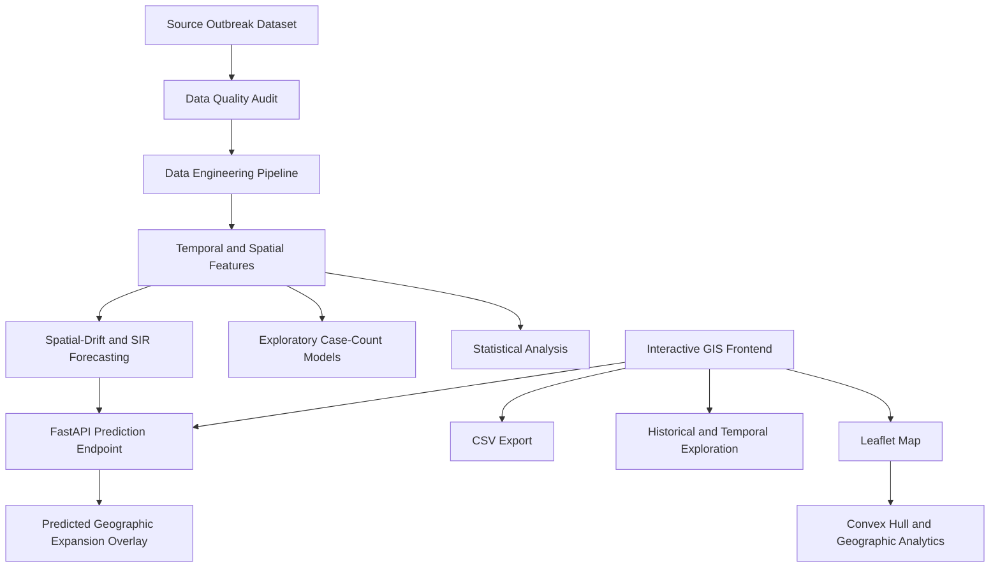

# Spatial Analytics Engine for Disease Outbreaks

### An interactive GIS platform and research pipeline for spatiotemporal outbreak analysis

[](https://outbreak-spatial-mapper.vercel.app/)
[](#research-and-analysis)
[](https://www.python.org/)

**Live Application:** https://outbreak-spatial-mapper.vercel.app/  
**GitHub Repository:** https://github.com/Vya234/outbreak-spatial-mapper

## Table of Contents

- [Overview](#overview)
- [Project Objectives](#project-objectives)
- [Key Features](#key-features)
- [System Architecture](#system-architecture)
- [Technology Stack](#technology-stack)
- [GIS and Spatial Analytics](#gis-and-spatial-analytics)
- [Data Engineering and Quality Assessment](#data-engineering-and-quality-assessment)
- [Research and Analysis](#research-and-analysis)
- [Forecasting Experiments](#forecasting-experiments)
- [Research Findings](#research-findings)
- [Repository Structure](#repository-structure)
- [Running the Project](#running-the-project)
- [Research Outputs](#research-outputs)
- [Limitations and Responsible Interpretation](#limitations-and-responsible-interpretation)
- [Future Work](#future-work)
- [Author](#author)

---

## Overview

The Spatial Analytics Engine for Disease Outbreaks is a GIS-based application and research project designed to explore the geographic and temporal patterns of reported disease cases.

The project began as an interactive mapping system that identifies the geographic extent of selected outbreak clusters. It was subsequently extended with a data engineering pipeline, district-level spatiotemporal analysis, spatial autocorrelation tests, data-quality audits, and exploratory case-count prediction experiments.

The system combines geospatial visualization with statistical analysis to investigate how reported cases vary across locations and time. The research component currently focuses on Acute Diarrhoeal Disease (ADD) records from Maharashtra, India, while additional data preparation and validation work has been performed on other disease subsets.

The project has two complementary components:

1. **Interactive GIS application:** Visualizes outbreak locations, geographic boundaries, and estimated outbreak regions.
2. **Research and analytics pipeline:** Audits source data, constructs temporal features, compares district-level patterns, evaluates spatial autocorrelation, and benchmarks exploratory prediction models.

The objective is to build a transparent and reproducible foundation for studying reported outbreak patterns—not to present the current system as a clinically validated or operational early-warning tool.

## Project Objectives

- Visualize reported outbreak locations on an interactive geographic map.
- Estimate the minimum geographic region enclosing a set of outbreak points.
- Analyze district-level variation in recorded disease cases across different periods.
- Investigate temporal coverage, reporting gaps, and potential data-quality issues.
- Examine whether neighboring districts exhibit statistically detectable spatial clustering.
- Compare simple baselines with machine-learning models using chronological evaluation.
- Explore a hybrid epidemiological and spatial-drift forecasting approach.
- Document the assumptions and limitations necessary for responsible interpretation.

## Key Features

| Component | Description |
|---|---|
| Interactive outbreak map | Explore geographic outbreak locations using Leaflet.js and OpenStreetMap. |
| Outbreak boundary estimation | Construct a convex hull around selected geographic points using the Monotone Chain algorithm. |
| Geographic area estimation | Use Turf.js for geographic calculations, including estimated polygon area. |
| Temporal exploration | Examine available outbreak records across time and inspect historical patterns. |
| Data export | Export supported map or outbreak data to CSV. |
| Data engineering | Aggregate observations into daily temporal features, including centroids and spread-radius estimates. |
| District-level analysis | Compare recorded case counts across districts and predefined periods. |
| Spatial statistics | Evaluate global spatial autocorrelation and local spatial patterns. |
| Model benchmarking | Compare training-median and Random Forest baselines under chronological splits. |
| Exploratory forecasting | Combine polynomial spatial-drift extrapolation with an SIR-based epidemiological component. |
| Research documentation | Maintain reproducible analysis scripts, tabular results, visualizations, and a BTP research report. |

## System Architecture

The project separates the interactive frontend from the prediction service and research analysis workflows.



### Application layer

The frontend provides an interactive geographic interface for exploring outbreak records and displaying estimated outbreak boundaries.

### Prediction layer

A FastAPI service exposes prediction functionality to the frontend. The frontend and prediction service are deployed separately.

### Research layer

Python scripts perform data audits, feature preparation, statistical analysis, spatial visualization, and chronological model evaluation. The resulting CSV files, figures, and written findings are stored in `research_outputs/`.

**Deployment:** Frontend on Vercel; FastAPI prediction service on Render.

## Technology Stack

| Area | Technologies |
|---|---|
| Frontend | HTML, JavaScript, Leaflet.js |
| Geographic data and calculations | OpenStreetMap, Turf.js, GeoJSON |
| Backend prediction service | Python, FastAPI |
| Data engineering | Python, Pandas, NumPy |
| Machine learning | Scikit-learn, Random Forest |
| Epidemiological modeling | Susceptible–Infected–Recovered (SIR) model, least-squares fitting |
| Statistical analysis | Spatial autocorrelation, permutation-based inference, district-level comparisons |
| Visualization | Matplotlib, Leaflet.js |
| Data formats | CSV, GeoJSON, Markdown, HTML |
| Deployment | Vercel, Render |
| Version control | Git, GitHub |

## GIS and Spatial Analytics

### 1. Geographic outbreak visualization

The application plots reported outbreak locations using geographic coordinates and interactive map layers. OpenStreetMap provides the map base, while Leaflet.js handles map rendering and interaction.

### 2. Convex hull construction

The Monotone Chain convex hull algorithm constructs the smallest convex polygon enclosing a set of two-dimensional points.

Given a collection of outbreak coordinates, the algorithm identifies the outermost points and constructs a polygon that encloses the selected cluster.

This provides a simple geographic envelope for visual exploration. A convex hull may include areas where no cases have been recorded, so it should not be interpreted as the actual infected area.

### 3. Geographic area estimation

Turf.js is used for geographic calculations, including estimating the area of supported polygons in square kilometres.

Area estimates depend on the input geometry and should be understood as geometric summaries rather than measurements of confirmed disease transmission.

### 4. Historical and temporal exploration

The application supports exploration of historical outbreak records and temporal changes. The research pipeline separately constructs reporting-aware time series to distinguish recorded observations from periods without observations.

### 5. Predicted expansion overlay

The prediction service can generate a seven-day exploratory geographic expansion region. The frontend renders this predicted region as a dashed overlay to distinguish it visually from the current outbreak boundary.

This layer is an experimental model output. It has not yet been independently validated against held-out future geographic boundaries.

## Data Engineering and Quality Assessment

The research workflow uses the original dataset at `data/Final_data.csv`, together with geographic boundary data and derived analysis files.

### Data preparation

The pipeline uses Python and Pandas to:

- Inspect data types, missing values, duplicate records, and temporal coverage.
- Examine district and disease-specific subsets.
- Aggregate eligible observations by date.
- Derive geographic centroids and great-circle spread radii using the Haversine formula.
- Prepare district-level and temporal summaries for statistical analysis.
- Preserve missing observations rather than automatically treating them as zero cases.

The Haversine formula estimates the great-circle distance between geographic coordinates on the Earth's surface. It is used to derive distance-based spatial summaries from the available coordinates.

### Source-data audit

The audit identified several issues that affect interpretation:

- The dataset contains missing values, particularly in the `Deaths`, `LAI`, and `Temp` fields.
- Exact duplicate groups exist when comparing records without the index-like `Unnamed: 0` column.
- The meaning of the `Cases` field and the reporting semantics of `week_of_outbreak` require careful interpretation.
- Reporting coverage varies substantially across years and districts.
- Some district-date groups contain conflicting case counts or week labels.

These issues are documented in the research outputs rather than silently corrected through unsupported assumptions.

### IDSP record validation

A small manually inspected sample of 13 selected records was compared against source IDSP bulletin text. All 13 selected records matched the inspected source.

This is a targeted validation check, not a complete validation of the dataset. It does not establish that every record is correct or that the source data are free from reporting inconsistencies.

### Coverage-aware temporal processing

The temporal workflow distinguishes between:

- A date with a recorded observation.
- A date with no observation in the available dataset.
- A period with sparse reporting coverage.

Dates without observations are not automatically assigned zero cases. This distinction is important because an absence of recorded cases does not necessarily mean that no cases occurred.

## Research and Analysis

The research component extends the original mapping application into a more systematic investigation of reported disease patterns.

### 1. District-level period comparisons

Maharashtra ADD observations were grouped into three predefined periods:

| Period | Districts represented | Records |
|---|---:|---:|
| 2009–2013 | 29 | 178 |
| 2014–2018 | 32 | 225 |
| 2019–2022 | 18 | 42 |

The first two periods were compared using districts with at least five observations in each period. This yielded 15 eligible districts.

For each eligible district, the analysis compared median recorded case counts across the two periods. The workflow also calculated district-level changes and uncertainty summaries.

### 2. Reporting-aware temporal analysis

The monthly timeline covers July 2009 through June 2022, comprising 156 calendar months.

The analysis explicitly records the uneven observation coverage:

- 40 months contain no observations.
- 55 observed months contain fewer than three records.

Consequently, monthly summaries are treated as descriptive statistics of the available records, not as complete statewide surveillance totals.

### 3. Global spatial autocorrelation

Global Moran's I was used to examine whether neighboring districts showed evidence of spatial autocorrelation in selected summaries of recorded ADD cases.

The analysis used district geographic boundaries and a Queen-contiguity spatial-neighbor graph. It also evaluated sensitivity to minimum-observation thresholds.

A non-significant result means that the analysis did not detect statistically significant global spatial autocorrelation under the tested setup. It does not prove that spatial relationships are absent.

### 4. Local spatial patterns

Local Indicators of Spatial Association (LISA) were used to explore potential local spatial patterns, including high–low and low–high relationships between a district and its neighbors.

These outputs are exploratory. Local clusters should not be interpreted as confirmed transmission hotspots, and inferential conclusions must account for sparse data, multiple testing, and the selected spatial weights.

### 5. Exploratory case-count model comparison

The model-comparison workflow evaluates whether district, month, and climate features improve retrospective prediction of recorded case counts.

Models include:

- Training-median baseline.
- Random Forest using district and month features.
- Random Forest using district, month, and climate features.

The experiments use chronological train/test cutoffs rather than random splits, helping evaluate models on records later than their training observations.

The current climate-feature experiment uses climate values measured on the target dates. Therefore, it is a retrospective prediction experiment and does not establish that those features would be available when making a real future forecast.

## Forecasting Experiments

The project includes an exploratory hybrid forecasting approach intended to extend spatial visualization with a predictive layer.

### Epidemiological component

A Susceptible–Infected–Recovered (SIR) compartmental model represents the simplified progression of a population through susceptible, infected, and recovered states.

The implementation fits model parameters using least-squares optimization against the available observations. The validity of the fitted parameters depends on the quality, timing, and interpretation of the input case series.

### Spatial-drift component

Polynomial trend regression is used to extrapolate the movement of outbreak centroids from historical geographic observations.

The data engineering pipeline derives daily centroid and spread-radius features from available coordinates, using great-circle distance calculations for spatial summaries.

### Hybrid output

The spatial and epidemiological components are combined in an exploratory forecasting workflow. The FastAPI backend exposes the prediction functionality, and the frontend can display a seven-day predicted expansion region as a dashed map overlay.

This implementation demonstrates an end-to-end predictive visualization workflow. It should not be considered a validated transmission model: the geographic expansion heuristic and its uncertainty assumptions still require independent evaluation against held-out future observations.

## Research Findings

The following findings summarize the current Maharashtra ADD analysis. They describe the available records and should not be generalized beyond the study design.

### District-level changes

Among the 15 districts with at least five observations in both 2009–2013 and 2014–2018:

- Eight districts had higher median recorded case counts in the later period.
- Seven districts had lower median recorded case counts.
- The median district-level change was +6 cases.
- The mean district-level change was approximately −4.97 cases.
- A paired Wilcoxon signed-rank test returned a p-value of approximately 0.629.

The analysis did not detect a statistically significant directional shift at the 5% level. Uneven reporting coverage and observation counts limit interpretation.

### Later-period coverage

The 2019–2022 subset contains 42 records across 18 districts, substantially fewer than the earlier periods. Only one district met the minimum five-observation requirement in both 2014–2018 and 2019–2022, preventing a meaningful statewide district-level comparison under the same eligibility rule.

### Global spatial autocorrelation

For district median recorded cases, the analysis obtained:

- Moran's I: approximately −0.0050.
- Permutation p-value: approximately 0.355.

The tested summaries did not provide statistically significant evidence of global spatial autocorrelation at the 5% level. This is not proof that local or temporal spatial relationships do not exist.

### Case-count model comparison

Across three chronological cutoffs, the climate-feature Random Forest had lower RMSE than the training-median baseline at each cutoff. Its MAE was not consistently lower than the baseline.

These results are preliminary and apply to retrospective recorded-case prediction. They do not validate the separate geographic expansion forecast.

## Repository Structure

The following is a high-level guide to the principal project files. It is not an exhaustive listing of every frontend or backend module.

```text
outbreak-spatial-mapper/
├── data/
│   ├── Final_data.csv
│   ├── boundaries/
│   │   └── maharashtra_districts.geojson
│   └── processed_dengue_mh.csv
├── scripts/
│   ├── audit_mh_add_district_gaps.py
│   ├── check_report.py
│   ├── compare_mh_add_fair_models.py
│   ├── final_report_audit.py
│   ├── inspect_add_records.py
│   ├── mh_add_coverage_aware_seasonality.py
│   ├── mh_add_reporting_aware_timeline.py
│   ├── mh_add_seasonality_robustness.py
│   ├── mh_add_spatiotemporal_maps.py
│   ├── plot_mh_add_fair_results.py
│   ├── rolling_origin_mh_add.py
│   ├── rolling_origin_mh_add_fair.py
│   └── validate_idsp_records.py
├── research_outputs/
│   ├── BTP_Report.html
│   ├── BTP_report_draft.md
│   ├── exact_duplicate_audit.csv
│   ├── idsp_validation.csv
│   ├── mh_add_coverage_aware_seasonality.csv
│   ├── mh_add_coverage_aware_seasonality.png
│   ├── mh_add_district_gap_audit.csv
│   ├── mh_add_district_period_comparison.csv
│   ├── mh_add_district_year_panel.csv
│   ├── mh_add_fair_model_comparison.csv
│   ├── mh_add_fair_model_comparison.png
│   ├── mh_add_period_change_uncertainty.csv
│   ├── mh_add_reporting_aware_monthly.csv
│   ├── mh_add_reporting_aware_timeline.png
│   ├── mh_add_seasonality_robustness.csv
│   ├── mh_add_spatiotemporal_findings.md
│   ├── mh_add_spatiotemporal_maps.png
│   ├── mh_add_spatiotemporal_summary.csv
│   ├── rolling_origin_mh_add_fair_results.csv
│   └── rolling_origin_mh_add_results.csv
├── index.html
├── .gitignore
└── README.md
```

The frontend and backend source files may include additional modules not shown in this abbreviated tree. The research scripts and outputs listed above represent the current analysis workflow.

## Running the Project

### Explore the deployed application

The easiest way to view the interactive map is through the live deployment:

**https://outbreak-spatial-mapper.vercel.app/**

The prediction service is deployed separately on Render.

### Clone the repository

```bash
git clone https://github.com/Vya234/outbreak-spatial-mapper.git
cd outbreak-spatial-mapper
```

### Run the research scripts

The analysis scripts are located in `scripts/`. Use Python 3 and install the dependencies required by the specific script before running it.

For example, the district-gap audit can be run from the repository root with:

```bash
python3 scripts/audit_mh_add_district_gaps.py
```

Other scripts generate or inspect specific analyses. Check each script's inputs, output paths, and dependencies before execution. Some scripts may overwrite generated outputs.

The frontend and FastAPI service have separate runtime requirements. Consult their respective source files and deployment configuration for exact local startup commands and environment variables.

### Data availability

The primary dataset and district-boundary file are present under `data/`. Additional source bulletin PDFs and extracted source text are not included in the current tracked research snapshot. Follow the source provider's terms and applicable redistribution permissions when obtaining or sharing those materials.

## Research Outputs

| File | Purpose |
|---|---|
| `mh_add_spatiotemporal_findings.md` | Written summary of the Maharashtra ADD spatiotemporal analysis. |
| `mh_add_spatiotemporal_summary.csv` | District-level spatial summary data. |
| `mh_add_spatiotemporal_maps.png` | Maps supporting the spatial analysis. |
| `mh_add_district_period_comparison.csv` | District comparisons across predefined periods. |
| `mh_add_period_change_uncertainty.csv` | Period-change summaries and uncertainty information. |
| `mh_add_reporting_aware_monthly.csv` | Monthly observations with reporting-coverage information. |
| `mh_add_reporting_aware_timeline.png` | Reporting-aware temporal visualization. |
| `mh_add_coverage_aware_seasonality.csv` | Coverage-aware seasonal summaries. |
| `mh_add_seasonality_robustness.csv` | Seasonality sensitivity analysis. |
| `mh_add_fair_model_comparison.csv` | Summary of baseline and feature-based model comparisons. |
| `rolling_origin_mh_add_fair_results.csv` | Results from chronological model evaluation. |
| `exact_duplicate_audit.csv` | Exact duplicate-group audit. |
| `idsp_validation.csv` | Selected manually checked IDSP source-record comparisons. |
| `BTP_report_draft.md` | Draft research report in Markdown. |
| `BTP_Report.html` | HTML version of the research report. |

## Limitations and Responsible Interpretation

The following limitations are important to the current state of the project:

1. **Uneven reporting coverage:** Record counts vary by district and year. The dataset may not represent complete disease incidence.
2. **Missing data:** Several variables have substantial missingness. Complete-case analyses can use a different subset of records from other analyses.
3. **Unresolved field definitions:** The interpretation of `Cases` and `week_of_outbreak` needs to remain tied to source documentation.
4. **Duplicate and conflicting records:** Identified duplicate groups and conflicting district-date values require source-aware handling.
5. **Sparse later-period data:** The 2019–2022 Maharashtra ADD subset is too sparse for some of the intended district comparisons.
6. **Statistical inference:** Non-significant results do not establish the absence of spatial or temporal structure. Local spatial analyses also require careful treatment of multiple testing.
7. **Retrospective model evaluation:** Climate values measured on target dates may not be available at prediction time. Current case-count results do not demonstrate operational forecast performance.
8. **Geographic forecast validation:** The seven-day expansion overlay has not been independently validated against held-out future outbreak boundaries.
9. **Model assumptions:** Polynomial spatial drift and SIR dynamics simplify complex transmission and geographic processes.
10. **Not a clinical or public-health decision system:** The application is an exploratory research tool and should not be used as the sole basis for public-health interventions.

## Future Work

Planned research directions include:

- Improve source-level data validation and document the definitions of all important fields.
- Investigate duplicate and conflicting records using original source bulletins.
- Develop reproducible spatial and temporal visualizations that account for reporting coverage.
- Extend the analysis to additional states and disease subsets when data quality permits.
- Record exact software versions, parameters, spatial weights, permutation settings, and temporal split definitions.
- Evaluate forecasting methods using strictly chronological, held-out observations.
- Ensure all predictor variables are available at the forecast origin.
- Compare predicted geographic boundaries with observed future boundaries using explicit spatial metrics.
- Calibrate uncertainty estimates using empirical validation rather than fixed assumptions.
- Investigate methods for identifying new potentially affected regions, subject to adequate temporal and geographic data.
- Improve reproducibility with documented environment setup and a single, well-defined analysis workflow.

## Author

**Kavya Rai**  
B.Tech, Computer Science and Engineering  
Indian Institute of Technology Kharagpur

Research project under the supervision of **Prof. Pabitra Mitra**, IIT Kharagpur.

- **Live Demo:** https://outbreak-spatial-mapper.vercel.app/
- **GitHub:** https://github.com/Vya234/outbreak-spatial-mapper

---

*This project is an ongoing research and software-engineering effort. Results and model outputs should be interpreted in light of the documented data-quality issues, assumptions, and validation limitations.*
