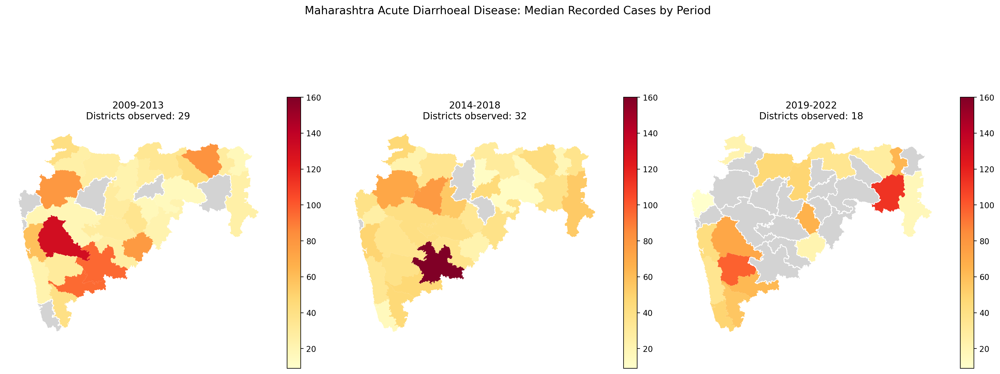
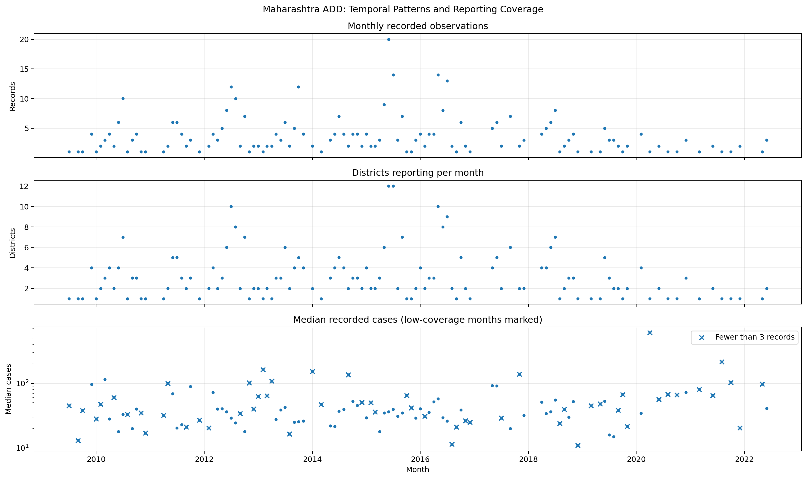
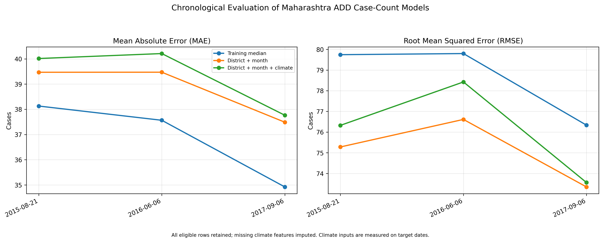
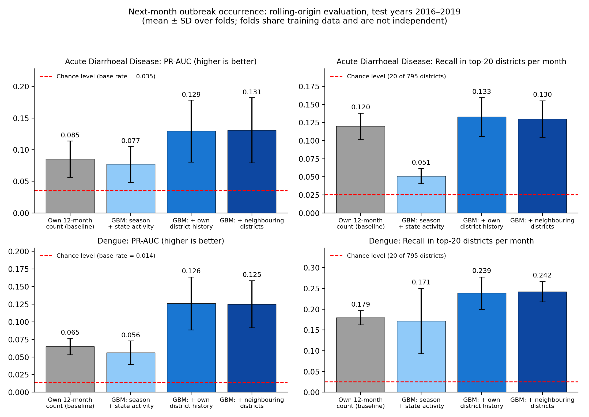
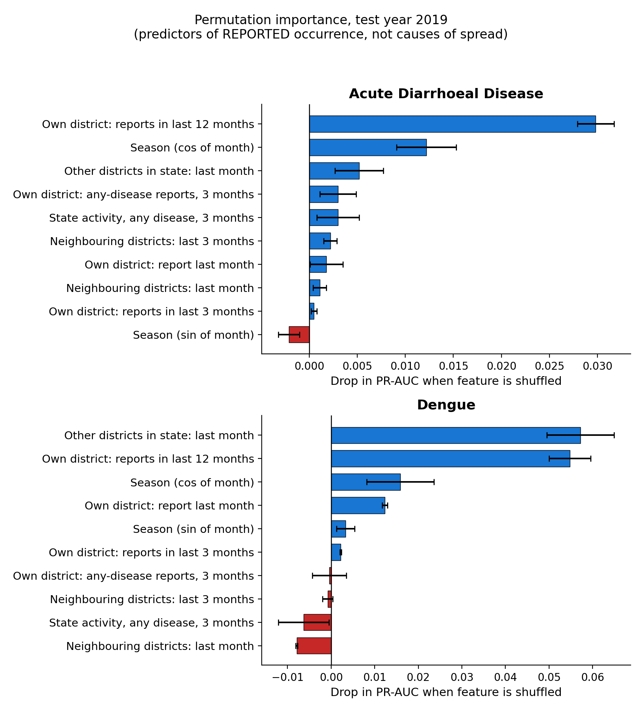

# Spatial Analytics Engine for Disease Outbreaks

## GIS-Based Spatio-Temporal Analysis and Exploratory Forecasting

**Project:** Spatial Analytics Engine for Disease Outbreaks **Research focus:** Spatial epidemiology, temporal analysis, and exploratory forecasting **Study area:** Maharashtra, India, with selected analyses of other Indian states **Dataset period:** 2009–2022 **Supervisor:** Prof. Pabitra Mitra, IIT Kharagpur

---

## Abstract

This project develops a geographic information system (GIS) for visualizing disease outbreak locations, analyzing spatial footprints, and exploring spatio-temporal forecasting methods. The application combines an interactive web interface, geospatial processing, a Python data-engineering pipeline, and a FastAPI prediction service. The research component investigates recorded Acute Diarrhoeal Disease (ADD) cases in Maharashtra using district-level spatial summaries, temporal visualizations, spatial autocorrelation analysis, period-wise comparisons, and exploratory case-count prediction experiments. The prepared Maharashtra ADD analysis contains 445 records. Reporting coverage varies substantially across the study period, with 178 records in 2009–2013, 225 in 2014–2018, and 42 in 2019–2022. Among 15 districts meeting the minimum observation requirement in both of the first two periods, eight showed an increase and seven showed a decrease in median recorded cases. Neither the Wilcoxon signed-rank test nor the sign test identified a statistically significant directional shift. Global Moran's I analysis also did not identify statistically significant spatial autocorrelation in district-level median cases. Exploratory case-count experiments compared a training-median baseline, a district-and-month Random Forest, and a model that also included climate features at three chronological cutoffs. The district-and-month model had lower RMSE but higher MAE than the median baseline at each cutoff. Adding climate features did not improve either metric over the district-and-month model. Because climate measurements were taken from the target dates, the experiment is retrospective and does not validate operational forecasting. A separate exploratory SIR experiment was conducted on a constructed dengue location timeline using chronological holdout evaluation. The SIR model achieved a holdout MAE of 13.996 and RMSE of 20.040, compared with 12.958 and 15.034, respectively, for a training-median baseline. The baseline outperformed the SIR model on both metrics. Because the target represents newly logged locations rather than verified new infections, the experiment is treated as an exploratory modelling investigation rather than validated epidemiological forecasting. The project demonstrates an integrated GIS and analytical workflow while highlighting the importance of reporting coverage, evaluation design, and careful interpretation of sparse epidemiological data. **Keywords:** GIS, spatial epidemiology, outbreak mapping, spatio-temporal analysis, Moran's I, Random Forest, climate features, disease surveillance.

---

## 1. Introduction

Disease surveillance data can help researchers understand where cases are recorded, how reported counts vary over time, and whether spatial patterns warrant further investigation. However, surveillance records are often irregular, incomplete, and affected by changes in reporting practices. Analytical systems must therefore communicate both observed patterns and uncertainty. This project combines an interactive GIS application with an analytical workflow for investigating recorded outbreak data. The engineering component supports geographic visualization and exploratory prediction, while the research component examines whether the available records support meaningful spatial, temporal, and predictive conclusions.

### 1.1 Problem statement

A useful outbreak-analysis system must do more than display case locations. It should support spatial footprint estimation, temporal exploration, structured data processing, and evaluation of predictive methods against simple baselines. At the same time, sparse and irregular surveillance data create important limitations. An apparent increase in recorded cases may reflect changing reporting coverage rather than a genuine increase in disease incidence. Similarly, a model that fits historical observations does not necessarily predict future outbreak expansion accurately.

### 1.2 Objectives

1\. Develop an interactive GIS interface for visualizing outbreak locations and their geographic footprint. 2\. Implement spatial processing and data-export functionality. 3\. Build a data-engineering and API pipeline for exploratory prediction. 4\. Analyze district-level and monthly patterns in Maharashtra ADD records. 5\. Examine spatial autocorrelation using Global Moran's I and local spatial statistics. 6\. Compare exploratory case-count models with a simple training-median baseline using chronological evaluation. 7\. Document data-quality issues, uncertainty, and limitations affecting interpretation.

---

## 2. System Architecture and Implementation

### 2.1 Interactive GIS frontend

The frontend uses HTML, JavaScript, Leaflet.js, and OpenStreetMap tiles to display geographic locations and outbreak boundaries. The principal capabilities include:

- Interactive placement and management of case-coordinate points.

- Convex-hull computation using the Monotone Chain algorithm.

- Geographic area estimation using Turf.js.

- Timeline controls for exploring outbreak scenarios.

- CSV export of coordinate data.

- Local persistence of interactive data using browser local storage.

- Historical district-level visualization using prepared summaries and

district boundaries. The convex hull represents the smallest convex polygon enclosing the provided points. It is a geometric footprint, not a probability distribution or a validated estimate of the actual area affected by disease transmission.

### 2.2 Data-engineering pipeline

The Python data-engineering workflow processes coordinate-based observations into daily features, including case counts, centroids, and geographic spread summaries. Great-circle distances can be calculated using the Haversine formula to estimate distances between geographic coordinates. These features provide inputs for exploratory spatial and temporal analysis. The interpretation of daily aggregates depends on the meaning and timing of the input records. Synthetic or manually entered points must not be treated as observed epidemiological surveillance data.

### 2.3 Prediction backend

The prediction service is implemented using FastAPI and exposes a prediction endpoint for frontend requests. The implemented forecasting components include:

- A fixed-growth radius heuristic (5% per forecast day) scaled by a clamped β/γ multiplier; no regression-based spatial drift model is implemented.

- A Susceptible-Infected-Recovered (SIR) compartmental model.

- Numerical parameter fitting against cumulative case curves.

- A heuristic that combines projected spatial radius with the fitted

epidemiological component.

- A frontend overlay showing the projected expansion zone.

The SIR model uses susceptible, infected, and recovered compartments and differential equations to represent a simplified transmission process. Its parameters and outputs depend on the validity of the input time series, initial conditions, and population assumptions. The current spatial projection uses a fixed-growth radius heuristic, scaled by a multiplier derived from the fitted beta/gamma ratio and bounded to a predefined range. It does not implement regression-based spatial drift. The projected expansion zone is an exploratory visualization, not a validated estimate of future geographic spread. Independent spatial forecast evaluation is required before making predictive performance claims.

### 2.4 Deployment

The frontend is deployed on Vercel and the FastAPI backend is hosted on Render. This separates the interactive user interface from the prediction service. Live demo: https://outbreak-spatial-mapper.vercel.app/ Repository: https://github.com/Vya234/outbreak-spatial-mapper

---

## 3. Dataset and Data Preparation

### 3.1 Source and variables

The research uses an EpiClim dataset supplied for the project. The dataset contains disease records spanning 2009–2022 and includes fields for disease, cases, deaths, reporting week, date components, state, district, coordinates, and environmental variables. The original fields include:

- Disease and case counts.

- Death counts.

- State and district names.

- Day, month, and year.

- Latitude and longitude.

- Precipitation (`preci`).

- Leaf Area Index (`LAI`).

- Temperature (`Temp`).

- An index-like column named `Unnamed: 0`.

The Maharashtra ADD spatial-temporal analysis uses 445 prepared records. Other analyses use different disease and state subsets; their sample sizes must be reported separately.

### 3.2 Data-quality assessment

The broader dataset contains 8,985 rows. The initial audit identified the following missing-value proportions:

| Variable | Missing |

|---|---:|

| Deaths | 71.6% |

| Precipitation | 1.5% |

| Leaf Area Index | 24.4% |

| Temperature | 10.4% |

An exact-duplicate audit identified 10 duplicate groups involving 20 rows when the index-like `Unnamed: 0` field was excluded from comparison. These groups included eight Acute Diarrhoeal Disease groups, one Dengue group, and one Malaria group. Potential duplicate records require source-level interpretation. Repeated entries may reflect duplicated ingestion, repeated bulletins, or separate reports. Therefore, the audit does not automatically justify deleting records from the source dataset. The stored outbreak-week field matched the ISO calendar week for 3,631 of 8,985 records (40.4%). This discrepancy does not establish that the stored week is incorrect: it may represent a reporting or bulletin week. The field should not be overwritten without a documented definition.

### 3.3 Irregular sampling

The Maharashtra ADD observations are irregularly sampled. Dates do not represent a complete daily or weekly series, and districts have different numbers of observations. Consequently:

- Missing dates must not automatically be interpreted as zero cases.

- A previous recorded observation is not necessarily a one-week lag.

- Comparisons should disclose observation counts and reporting coverage.

- Forecasting evaluations must preserve chronological order.

- Claims about incidence require appropriate population denominators and

information about surveillance coverage.

### 3.4 External record validation

A subset of records was checked against manually inspected NCDC/IDSP weekly bulletin text. The validation file contains 13 selected records marked `MATCH`. This establishes agreement for those checked entries only. It does not establish that every row in the complete dataset is correct or that the dataset is free from duplication.

---

## 4. Spatio-Temporal Analysis of Maharashtra ADD

### 4.1 Study subset and period grouping

The analysis uses 445 prepared Maharashtra ADD records grouped into three periods:

| Period | Districts observed | Records |

|---|---:|---:|

| 2009–2013 | 29 | 178 |

| 2014–2018 | 32 | 225 |

| 2019–2022 | 18 | 42 |

District medians were calculated from available observations. Districts without observations in a period were left unreported rather than assigned zero. The district labels Sholapur and Solapur were normalized for spatial comparison. The raw source labels should remain preserved in the original data.

### 4.2 Period-wise district comparison

A district was included in a pairwise comparison only if it had at least five observations in both periods. This practical threshold reduces comparisons based on extremely small samples but does not guarantee statistical reliability. Fifteen districts met this criterion for 2009–2013 versus 2014–2018:

- Eight districts had higher median recorded cases.

- Seven districts had lower median recorded cases.

- The median district-level change was +6 cases.

- The mean district-level change was -4.97 cases.

Examples of observed changes include:

| District | Earlier median | Later median | Change |

|---|---:|---:|---:|

| Gadchiroli | 25 | 54 | +29 |

| Nanded | 21.5 | 39 | +17.5 |

| Sangli | 95 | 47 | -48 |

| Pune | 131 | 36 | -95 |

The mean change was influenced by large decreases in some districts. These statistics describe recorded counts, not population-adjusted incidence.

### 4.3 Statistical tests

For the 15 districts comparable across 2009–2013 and 2014–2018:

| Test | Statistic | p-value |

|---|---:|---:|

| Wilcoxon signed-rank test | 51.5 | 0.629 |

| Two-sided sign test | — | 1.000 |

Neither test provided evidence of a consistent directional shift at the conventional 5% significance level. This does not prove that disease incidence remained stable. The comparison is exploratory and is affected by sparse observations, changing reporting coverage, and the practical inclusion threshold. Only Kolhapur met the minimum observation requirement in both 2014–2018 and 2019–2022. Therefore, a meaningful statewide comparison involving the final period was not possible under this criterion.

### 4.4 Monthly timeline and reporting coverage

The monthly timeline covers July 2009 to June 2022 and reindexes the data to a complete calendar of 156 months.

- Months without observations: 40.

- Observed months with fewer than three records: 55.

- The largest observed monthly median was 607 cases in April 2020.

- That value came from a single record from one district.

The April 2020 value must not be interpreted as a statewide outbreak peak. The monthly visualization presents reporting counts, districts reporting, and median recorded cases. Months with limited reporting are explicitly identified, and missing months are retained as missing rather than set to zero. The case-summary panel uses a logarithmic vertical axis. Its values should therefore be interpreted on a log scale. The timeline describes the available records; it does not establish continuous disease incidence, a causal trend, or reliable seasonality.

---

## 5. Spatial Autocorrelation Analysis

### 5.1 Method

Global Moran's I was used to assess whether district-level case summaries exhibited spatial autocorrelation under the selected district-neighbour definition (Moran, 1950). Local Indicators of Spatial Association (LISA) were also used to explore local spatial patterns (Anselin, 1995). The analysis normalized Sholapur to Solapur to align the data with the district boundary layer. The matched spatial analysis contained 34 districts.

### 5.2 Global Moran's I results

| District summary | Moran's I | Permutation p-value |

|---|---:|---:|

| Median cases | -0.0050 | 0.3551 |

| Mean cases | 0.1048 | 0.1226 |

| Maximum cases | 0.0018 | 0.3585 |

None of the three global statistics was significant at the 5% level. A robustness analysis varying the minimum number of observations per district also produced non-significant global Moran's I results. The number of included districts decreased as the threshold increased, reducing the coverage of the analysis.

### 5.3 Local patterns and multiple-testing correction

Local Indicators of Spatial Association (LISA) were used to examine local spatial patterns in district-level median recorded cases. Using a permutation-based significance threshold of \(p < 0.05\), five districts showed nominally significant local associations: Ahmednagar, Washim, Satara, Chandrapur, and Osmanabad. Their classifications included Low-High and High-Low patterns. However, local spatial analysis involves multiple simultaneous hypothesis tests. After applying both Bonferroni correction and the Benjamini–Hochberg false discovery rate (FDR) procedure across the 34 districts, none of the local associations remained statistically significant at the 5% level. Consequently, the nominal local classifications should be treated as exploratory rather than as confirmed spatial clusters or outliers. The analysis does not establish disease transmission between neighbouring districts.

### 5.4 Interpretation and limitations

The global Moran's I statistic for district-level median recorded cases was -0.0050, with a permutation p-value of 0.3551. The analysis therefore did not detect statistically significant global spatial autocorrelation in this summary. No local associations remained significant after multiple-testing correction. These findings do not establish that geographic factors are irrelevant or that spatial dependence is absent. Results may be affected by sparse and uneven observations, differences in reporting, district-level aggregation, the selected spatial-neighbour definition, and the statistical power of the tests. The local permutation analysis was rerun with an explicit random seed to improve reproducibility. The global Moran's I calculation used the installed implementation, which does not expose a seed parameter through its standard function signature. Accordingly, the explicit-seed reproducibility statement applies to the local analysis, not necessarily to every permutation calculation in the study.

---

## 6. Exploratory Case-Count Prediction

### 6.1 Research question

The predictive experiments investigate whether district identity, calendar month, and climate variables help predict recorded case counts compared with a simple baseline. These experiments are separate from the frontend's heuristic prediction of geographic expansion. Good performance on case-count prediction would not, by itself, validate a forecast of future outbreak boundaries.

### 6.2 Models

Three models were compared: 1\. **Training-median baseline:** predicts the median case count in the training data. 2\. **District + month:** a Random Forest model using district identity and calendar month. 3\. **District + month + climate:** a Random Forest model adding temperature, precipitation, and Leaf Area Index. The Random Forest experiments used 300 trees, a minimum leaf size of five, and a fixed random seed. District identity was one-hot encoded. In the corrected experiment, missing climate values were imputed using median values learned within the training pipeline; rows were not excluded solely because climate measurements were missing.

### 6.3 Chronological evaluation

The corrected rolling-origin comparison used chronological cutoffs. At each cutoff, all three models were evaluated on the same test rows. Missing climate values were imputed within the training pipeline, rather than excluding rows with incomplete climate measurements. The climate measurements correspond to the target dates. Therefore, this is a retrospective comparison, not a deployable future forecast using only information available before the target date.

| Cutoff | Model | Training rows | Test rows | MAE | RMSE |

|---|---|---:|---:|---:|---:|

| 2015-08-21 | Training median | 258 | 174 | 38.129 | 79.743 |

| 2015-08-21 | District + month | 258 | 174 | 39.469 | 75.280 |

| 2015-08-21 | District + month + climate | 258 | 174 | 40.014 | 76.324 |

| 2016-06-06 | Training median | 302 | 130 | 37.565 | 79.798 |

| 2016-06-06 | District + month | 302 | 130 | 39.471 | 76.612 |

| 2016-06-06 | District + month + climate | 302 | 130 | 40.211 | 78.424 |

| 2017-09-06 | Training median | 348 | 84 | 34.923 | 76.335 |

| 2017-09-06 | District + month | 348 | 84 | 37.489 | 73.347 |

| 2017-09-06 | District + month + climate | 348 | 84 | 37.765 | 73.560 |

MAE is mean absolute error; RMSE is root mean squared error. Lower values indicate better performance.

### 6.4 Results

Across all three cutoffs, the district-and-month model had lower RMSE than the training-median baseline, but its MAE was higher. Adding climate features did not improve either metric relative to the district-and-month model: the climate model had higher MAE and RMSE at every cutoff. Relative to the training-median baseline, the district-and-month model's RMSE was lower by approximately 5.60%, 3.99%, and 3.91% at the three cutoffs, respectively. The corresponding reductions for the climate model were approximately 4.29%, 1.72%, and 3.64%. Neither Random Forest model improved MAE over the baseline at any cutoff. These results do not provide evidence that the tested climate features improved case-count prediction under this evaluation protocol. The test windows overlap across cutoffs, so the results should not be treated as three independent replications.

### 6.5 Important forecasting limitation

The climate variables were measured on the same dates as the target case counts. Consequently, the experiment is a retrospective prediction exercise using contemporaneous climate data. In a genuine future forecast, these inputs would need to be available at prediction time, for example through lagged climate observations or weather forecasts. The evaluation predicts recorded case counts at observed dates. It does not validate future geographic spread, the SIR-derived radius multiplier, or the accuracy of the frontend's predicted expansion boundary.

### 6.6 Outbreak-occurrence forecasting (district-month panel)

**Motivation.** EpiClim rows are reported outbreak events. A district-month without a row means that no report was recorded, not that zero cases occurred (Section 3.3). The case-count experiments in Sections 6.1–6.5 condition on a report existing. This experiment instead asks whether a district will report an outbreak of a given disease in the next month. **Problem definition.** For each district and month $m$, the target is whether the district records at least one reported outbreak of the disease in month $m$+1. Inputs use only information from months up to $m$. The panel covers 795 districts (taken from the full dataset) over 158 months (May 2009–June 2022). The target diseases are Acute Diarrhoeal Disease (5,126 records) and Dengue (1,619 records), matched on the exact `Disease` label. Related labels are excluded: 79 records containing "dengue" (for example "Dengue Fever", "Suspected Dengue" and mixed dengue/chikungunya labels) and 102 gastroenteritis and diarrhoea variants. Across the test years, 3.5% of district-months had a reported ADD outbreak and 1.4% had a reported dengue outbreak. **Features.** All features are computed from months up to $m$:

- Season: sine and cosine of the target calendar month.

- Own district: reports of the target disease in the last month, last 3 months and last 12 months, and any-disease reports in the last 3 months.

- Rest of the state: reports of the target disease in month $m$, and any-disease reports in the last 3 months, in the other districts of the same state.

- Neighbouring districts: the mean number of reports in the last month and last 3 months across the five nearest district centroids. District coordinates are fixed per district in the dataset. This differs from the Queen-contiguity weights used for Maharashtra in Section 5, because no national boundary file is used here.

**Models.** The baseline ranks districts by their number of reports of the target disease in the previous 12 months. Three gradient-boosted tree models (scikit-learn `HistGradientBoostingClassifier`; within the general gradient-boosting framework described by Friedman (2001); maximum depth 4, learning rate 0.05, 200 iterations, random seed 0, no hyperparameter tuning) use cumulative feature sets: season and state activity; plus own-district history; plus neighbouring districts. **Evaluation.** Rolling-origin evaluation preserves temporal ordering, which is important for structured data (Roberts et al., 2017). For each test year from 2016 to 2019, models are trained on all earlier months and tested on the 12 target months of that year. The years 2020–2022 are excluded because reporting drops sharply (151, 367 and 188 records, compared with 572–1,113 per year in 2010–2019). Metrics are PR-AUC (chance level equals the base rate), ROC-AUC, and recall in the top 20 districts per month. For the last metric, in each test month with at least one reported outbreak, the 795 districts are ranked by predicted score and the fraction of that month's outbreak districts found among the top 20 is recorded (chance level 20/795 = 2.5%). **Results.** Table 6.6 gives the means over the four test years.

| Disease | Model | PR-AUC | ROC-AUC | Recall in top 20 |

|---|---|---:|---:|---:|

| Acute Diarrhoeal Disease (base rate 0.035) | Own 12-month count (baseline) | 0.085 | 0.680 | 0.120 |

| | GBM: season + state | 0.077 | 0.671 | 0.051 |

| | GBM: + own-district history | 0.129 | 0.755 | 0.133 |

| | GBM: + neighbouring districts | 0.131 | 0.756 | 0.130 |

| Dengue (base rate 0.014) | Own 12-month count (baseline) | 0.065 | 0.705 | 0.180 |

| | GBM: season + state | 0.056 | 0.749 | 0.171 |

| | GBM: + own-district history | 0.126 | 0.819 | 0.239 |

| | GBM: + neighbouring districts | 0.125 | 0.822 | 0.242 |

**\\*Table 6.6. Mean over test years 2016–2019. Source: `research_outputs/occurrence_rolling_results.csv`. Figure 5 (Appendix B.5) shows the same results with variation across years.\\***

- Models that use the district's own history are well above chance (PR-AUC 0.129 against a base rate of 0.035 for ADD; 0.126 against 0.014 for dengue).

- Compared with the baseline, the model with own-district history had higher PR-AUC in all four test years for both diseases. For recall in the top 20 districts it was higher in all four years for dengue and in three of four years for ADD (not in 2019).

- The variation across test years is large (error bars in Figure 5), so the size of the improvement over the baseline is uncertain. For ADD, the top-20 recall gain is small (0.133 against 0.120).

- Season and state activity alone did not beat the baseline on PR-AUC (ADD 0.077 against 0.085; dengue 0.056 against 0.065), so a district's own reporting history carries most of the signal.

- Neighbouring-district features gave no measurable gain (PR-AUC 0.131 against 0.129 for ADD; 0.125 against 0.126 for dengue). This is consistent with the non-significant Moran's I in Section 5, but it does not show that spatial transmission is absent: it only shows that, under this neighbour definition and these data, nearby reports did not improve next-month prediction.

**Robustness to reporting footprint.** Unreported months cannot be confirmed as true negatives, so the experiment was repeated on districts with a stronger reporting history. For each test year, a district was eligible if it had at least 6 (or at least 12) months with a recorded report of the target disease in the training period only. Models and features were unchanged, and only the test rows were filtered (`occurrence_robustness.py`). The thresholds are exploratory choices. Table 6.7 gives the results.

| Disease | Eligible districts | Positives per year | Base rate | Baseline PR-AUC | GBM (own history) PR-AUC | GBM lift over base rate |

|---|---|---:|---:|---:|---:|---:|

| ADD, all districts | 795 | 273–477 | 0.035 | 0.085 | 0.129 | 3.7× |

| ADD, ≥6 recorded months | 152–228 | 144–226 | 0.077 | 0.127 | 0.180 | 2.4× |

| ADD, ≥12 recorded months | 33–78 | 59–84 | 0.112 | 0.167 | 0.231 | 2.1× |

| Dengue, all districts | 795 | 97–152 | 0.014 | 0.065 | 0.126 | 9.2× |

| Dengue, ≥6 recorded months (low sample) | 26–48 | 26–49 | 0.083 | 0.125 | 0.246 | 2.9× |

| Dengue, ≥12 recorded months (low sample) | 5–15 | 8–27 | 0.129 | 0.172 | 0.281 | 2.2× |

**\\*Table 6.7. Mean over test years 2016–2019. PR-AUC is not comparable across rows because base rates differ. "Low sample" marks sets with fewer than 30 positive district-months in at least one test year; this cut-off is a practical warning rule, not a statistical standard. Source: `research_outputs/occurrence_robustness_summary.csv`.\\***

- The model with own-district history had higher PR-AUC than the 12-month-count baseline in all four test years in every eligibility set, for both diseases.

- Its lift over the base rate shrinks as eligibility becomes stricter (ADD 3.7×, 2.4×, 2.1×; dengue 9.2×, 2.9×, 2.2×). Part of the performance on all districts therefore comes from separating districts that report at all from those that rarely do. Among districts that already report regularly, the model still ranks future reports above chance, but by a smaller margin.

- The restricted dengue sets contain only 5–48 districts and 8–49 positives per year, so those estimates are exploratory.

- Neighbouring-district features again gave no consistent gain (for example ADD ≥6: 0.180 against 0.180; ADD ≥12: 0.227 against 0.231).

- A district with many past reports is not necessarily fully monitored, so this analysis does not resolve the missing-negative-label problem.

**Permutation importance.** Figure 6 (Appendix B.6) shows the drop in PR-AUC on the 2019 test year when each feature is shuffled. For ADD, the largest values were the own-district 12-month count (0.0298), the seasonal cosine term (0.0122) and other districts in the state reporting in the last month (0.0052); all others were 0.003 or smaller. For dengue, the other-districts-in-state feature (0.0572, SD 0.0077) and the own-district 12-month count (0.0548, SD 0.0048) were the largest and are not clearly separable, followed by season (cosine 0.0159) and the own-district last-month report (0.0123). The neighbouring-district features had negative values for dengue (−0.0079 and −0.0008), which indicates that they contribute no useful signal. **Interpretation.** These importance values describe which inputs the model uses to predict **\\*reported\\*** occurrence. A district's own history partly reflects how often it reports at all, so the values must not be read as causes of disease spread. They are computed on a single test year, and correlated features share importance. **What this experiment does not show.**

- It evaluates whether a district reports an outbreak next month. It does not validate the seven-day geographic expansion overlay, which remains unvalidated.

- Outcomes are reports, not true incidence.

- The district list and coordinates come from the full dataset, including later years, which is a minor source of leakage in the definition of the district universe.

- Only one hyperparameter setting was used, and the four test years share training data and are not independent.

- Climate variables were not used: they are present only on reported rows (5,997 of 8,985 rows have all three), so no climate values exist for district-months without a report. Lagged climate was therefore not evaluated.

- Only two diseases were studied, and the years 2020–2022 were not evaluated.

**Reproducibility.** `occurrence_model.py` writes `occurrence_rolling_results.csv` and `occurrence_permutation_importance.csv` to `research_outputs/`, `plot_occurrence_results.py` produces Figures 5 and 6 from those files, and `occurrence_robustness.py` writes `occurrence_robustness_by_year.csv` and `occurrence_robustness_summary.csv`. Results were produced with scikit-learn 1.7.2 and pandas 2.3.3.

---

### 6.7 Seven-step forecast benchmark on the constructed timeline

**Objective.** A separate experiment compared simple forecasting baselines for the `newly_logged` series derived from the processed Maharashtra dengue records. This experiment evaluates numerical predictions over seven consecutive observations on the constructed timeline. It does not evaluate seven calendar days of confirmed dengue incidence. **Evaluation design.** The rolling-origin procedure begins after 120 observations and advances in seven-observation blocks. Each method produces a constant prediction across the next block. The compared methods are the expanding training median, last-observation persistence, recent seven- observation median, recent seven-observation mean, and a 50--50 median ensemble. The ensemble results are recorded separately in `research_outputs/7day_ensemble_summary.csv`. **Results.** Table 6.8 reports the pooled metrics available for the five methods.

| Method | Test blocks | Test observations | MAE | RMSE |

|---|---:|---:|---:|---:|

| Expanding training median | 39 | 272 | 12.612 | 15.275 |

| Last-observation persistence | 39 | 272 | 15.375 | 19.905 |

| Recent seven-observation median | 39 | 272 | 12.412 | 16.045 |

| Recent seven-observation mean | 39 | 272 | 12.580 | 15.268 |

| 50--50 median ensemble | 39 | 272 | 12.093 | 15.131 |

\\*Table 6.8. Pooled rolling-origin performance on the constructed observation timeline. Lower MAE and RMSE indicate lower numerical prediction error. Sources: `7day_forecast_summary.csv` and `7day_ensemble_summary.csv`.\\* The 50--50 median ensemble achieved the lowest pooled MAE and RMSE among the methods listed. Persistence performed worst on both metrics. The differences between the ensemble and the other median-based methods were modest, so the result should be interpreted as a comparative benchmark rather than evidence of a generally superior forecasting system. **Interpretation and limitations.** The timeline's daily index represents the order of constructed observations, not elapsed calendar time. The `newly_logged` target counts locations first logged on each constructed timeline day; it is not a verified daily incidence series. Therefore, the experiment does not establish the accuracy of a seven-calendar-day dengue forecast. The results are useful for comparing baseline methods under this specific data construction, but their epidemiological meaning is limited. The experiment also does not validate the geographic expansion overlay displayed by the frontend.

### 6.8 SIR parameter fitting and holdout evaluation

**Model.** The Susceptible–Infected–Recovered (SIR) model, following the classical compartmental epidemic-modelling tradition of Kermack and McKendrick (1927), represents the population using susceptible (S), infected (I), and recovered (R) compartments. Its differential equations are:

\[
\begin{aligned}
\frac{dS}{dt} &= -\beta \frac{SI}{N},\\
\frac{dI}{dt} &= \beta \frac{SI}{N} - \gamma I,\\
\frac{dR}{dt} &= \gamma I.
\end{aligned}
\]

Here, N denotes the assumed population size, while β and γ are transmission and recovery parameters. The implementation numerically integrates these equations and estimates N, β, and γ by minimizing mean squared error between the observed cumulative series and modelled I + R. Parameter optimization uses bounded multi-start L-BFGS-B fitting. **Data and target.** The experiment uses `data/processed_dengue_mh.csv`, which contains 392 observations indexed by a constructed timeline. The daily `newly_logged` target represents newly logged locations per constructed time step, not verified daily new infections. The timeline index does not establish that observations correspond to consecutive calendar days. **Holdout design.** The first 274 observations (70%) were used for training; the remaining 118 observations (30%) were held out chronologically. The SIR parameters were fitted using training observations only. The baseline predicts the training median, 20, for every holdout observation. Both methods were evaluated on the same holdout rows using mean absolute error (MAE) and root mean squared error (RMSE). **Fitting results.** Bounded multi-start optimization converged successfully. The selected fit returned N = 65,418.2, β = 0.3201, and γ = 0.3055, with a training cumulative-fit MSE of 42,583.653. These fitted values are exploratory and are not independently validated epidemiological parameters. **Holdout results.**

| Method | Holdout MAE | Holdout RMSE |

|---|---:|---:|

| Training-median baseline | 12.958 | 15.034 |

| SIR model | 13.996 | 20.040 |

**Table 6.9. Chronological holdout results from `research_outputs/sir_holdout_validation.csv`. Lower values indicate lower prediction error.** The SIR model's MAE was 1.038 higher than the baseline's, and its RMSE was 5.006 higher. The median baseline therefore performed better on both metrics. The SIR model's predictions were not uniformly near zero in this updated fit; its performance should be described using the final holdout metrics above, not the results of the earlier model version. **Parameter sensitivity.** Earlier diagnostic runs found that estimates could depend strongly on the population initialization and could reach parameter bounds. In the current multi-start fit, different successful starts also produced materially different loss values and parameter estimates. This raises concerns about parameter identifiability and fit stability for the available series. Convergence indicates that an optimizer met its stopping criterion; it does not establish epidemiological validity or predictive usefulness. **Interpretation and limitations.** The experiment did not demonstrate a predictive advantage over a simple baseline. Moreover, the target measures logged locations on a constructed timeline rather than validated infection incidence. Consequently, the fitted parameters should not be interpreted as reliable epidemiological estimates. The SIR experiment is retained as an exploratory negative result. Further work would require a defensible temporal target, explicit population and initial-condition assumptions, parameter identifiability analysis, and independent validation. **Reproducibility.** The held-out predictions were saved to `research_outputs/sir_holdout_validation.csv`. The file contains the timeline index, observed daily logged count, median-baseline prediction, and SIR prediction. The experiment can be reproduced using `scripts/validate_sir_forecast.py` and `forecasting_engine.py`.

## 7. Discussion

The project integrates geospatial software engineering with exploratory epidemiological analysis. Its primary strengths are the interactive spatial interface, modular backend, reproducible analytical scripts, explicit reporting-coverage analysis, and comparison of predictive models against a simple baseline. The research results also demonstrate why data limitations must be part of the analysis rather than an afterthought. First, uneven reporting makes it difficult to interpret changes in recorded cases as changes in disease incidence. Second, global spatial autocorrelation was not statistically significant for the selected district summaries. Third, across all three chronological cutoffs in the corrected case-count experiment, the district-and-month model achieved lower RMSE but higher MAE than the training-median baseline. Adding climate features did not improve either MAE or RMSE over the district-and-month model. These findings are not failures of the project. They identify which conclusions are supported by the available data and where stronger validation is needed. The separate SIR experiment further illustrates the distinction between model fitting and predictive performance. Although bounded multi-start optimization converged, the fitted model did not outperform the training-median baseline on the chronological holdout set. The target series represents newly logged locations on a constructed timeline rather than verified daily infection incidence, limiting the epidemiological interpretation of the fitted parameters. This negative result is useful because it identifies the need for a better-defined temporal target, stronger data validation, and independent evaluation before a compartmental model can be considered suitable for outbreak forecasting.

---

## 8. Limitations

1\. **Reporting coverage:** Observation counts vary across districts, years, and months. 2\. **Irregular sampling:** The data do not form a complete daily or weekly surveillance series. 3\. **Missing values:** Death and climate variables have missing observations. 4\. **Case-count interpretation:** Recorded counts are not population-adjusted incidence rates. 5\. **Duplicate ambiguity:** Repeated entries require source-level interpretation before removal. 6\. **Limited external validation:** Only a small selected subset was checked against IDSP bulletin text. 7\. **Spatial aggregation:** District-level summaries can conceal local variation within districts. 8\. **Prediction inputs:** Contemporaneous climate measurements limit the operational interpretation of the retrospective experiment. 9\. **Forecast validation:** The geographic expansion heuristic has not yet been independently validated against held-out future outbreak boundaries. 10\. **Uncertainty:** Fixed radius adjustments and limited empirical uncertainty calibration do not establish statistically calibrated prediction intervals. 11\. **Generalizability:** Results for Maharashtra ADD cannot automatically be generalized to other diseases or states. 12\. **SIR fitting and predictive limitations:** The SIR model was fitted using bounded multi-start optimization, but convergence did not translate into improved holdout performance. On a chronological split of 274 training and 118 test observations, the SIR model achieved an MAE of 13.996 and RMSE of 20.040, compared with 12.958 and 15.034 for the training-median baseline. The experiment used newly logged locations rather than verified new infections, and its constructed timeline does not establish consecutive calendar-day observations. Consequently, the fitted population, transmission, and recovery parameters cannot be treated as validated epidemiological estimates. Further work requires a well-defined temporal target, assessment of parameter identifiability, and independent predictive validation.

---

## 9. Future Work

### 9.1 Strengthen data validation

- Document the source definitions of reporting week, case counts, and

repeated records.

- Preserve original records and maintain an auditable preprocessing log.

- Expand bulletin validation using a defined sampling strategy.

- Investigate district-name and geographic-boundary mismatches.

### 9.2 Improve temporal analysis

- Continue displaying the number of reporting districts alongside case

summaries.

- Explore models appropriate for irregular observations.

- Assess whether the available coverage supports seasonal analysis before

making seasonal claims.

- Separate reporting-process changes from possible epidemiological changes.

### 9.3 Improve forecasting evaluation

- Evaluate models using strictly chronological splits.

- Compare against appropriate baselines on identical test observations.

- Use lagged or genuinely forecast-available climate inputs.

- Report errors by disease, district, forecast horizon, and coverage level.

- Keep case-count evaluation separate from spatial expansion evaluation.

- Validate geographic forecasts against held-out future observations before

claiming operational usefulness.

- Estimate uncertainty empirically and test its calibration.

- Reassess the SIR experiment using a clearly defined temporal target and

observations with verified calendar dates, where available.

- Evaluate parameter identifiability and sensitivity to initialization

before assigning epidemiological interpretations to fitted parameters.

- Compare compartmental models with simple baselines using chronological

holdout evaluation and retain the baseline when it performs better.

### 9.4 Spatial and epidemiological extensions

- Investigate spatial and spatio-temporal models if data density permits.

- Examine alternative spatial weights and sensitivity to district coverage.

- Explore prediction of newly affected regions only after defining a

reliable event-level target and validation protocol.

- Consider population denominators and additional covariates where

appropriate data are available.

---

## 10. Conclusion

This project presents an integrated GIS application and an exploratory research workflow for disease-outbreak analysis. It combines interactive geographic visualization, convex-hull-based spatial footprints, data processing, a prediction API, district-level spatio-temporal analysis, spatial autocorrelation tests, and chronological case-count model comparisons. The Maharashtra ADD analysis did not detect a statistically significant directional shift between the first two comparison periods or significant global spatial autocorrelation in the selected district summaries. Reporting coverage was too uneven to support a meaningful statewide comparison involving 2019–2022 under the chosen observation threshold. In the corrected case-count experiment, adding climate features did not improve MAE or RMSE relative to the district-and-month Random Forest. Both Random Forest models had lower RMSE but higher MAE than the training-median baseline at all three cutoffs. Because climate features were measured on target dates, the results remain retrospective rather than a validated operational forecast. The SIR experiment provided an additional evaluation of compartmental modelling on the constructed dengue location timeline. Although the fitting procedure converged, the model did not outperform the median baseline on the chronological holdout set. This result reinforces the importance of defining meaningful targets, accounting for reporting limitations, and evaluating predictive models against simple benchmarks. The SIR component therefore remains exploratory rather than a validated disease-incidence forecasting method. The central contribution is an integrated and reproducible analytical workflow that makes spatial patterns and reporting limitations visible while establishing a clear foundation for more rigorous spatio-temporal forecasting research.

---

## References

1\. Anselin, L. (1995). Local Indicators of Spatial Association—LISA. **\\*Geographical Analysis, 27\\***(2), 93–115. https://doi.org/10.1111/j.1538-4632.1995.tb00338.x 2\. Friedman, J. H. (2001). Greedy function approximation: A gradient boosting machine. **\\*The Annals of Statistics, 29\\***(5), 1189–1232. https://doi.org/10.1214/aos/1013203451 3\. Kermack, W. O., & McKendrick, A. G. (1927). A contribution to the mathematical theory of epidemics. \\*Proceedings of the Royal Society of London. Series A, 115\\*(772), 700–721. https://doi.org/10.1098/rspa.1927.0118 4\. Moran, P. A. P. (1950). Notes on continuous stochastic phenomena. **\\*Biometrika, 37\\***(1–2), 17–23. https://doi.org/10.1093/biomet/37.1-2.17 5\. Roberts, D. R., Bahn, V., Ciuti, S., Boyce, M. S., Elith, J., Guillera-Arroita, G., Hauenstein, S., Lahoz-Monfort, J. J., Schröder, B., Thuiller, W., Warton, D. I., Wintle, B. A., Hartig, F., & Dormann, C. F. (2017). Cross-validation strategies for data with temporal, spatial, hierarchical, or phylogenetic structure. **\\*Ecography, 40\\***(8), 913–929. https://doi.org/10.1111/ecog.02881

---

## Appendix A. Reproducibility and Supporting Outputs

Key analysis outputs include:

- `research_outputs/mh_add_spatiotemporal_findings.md`

- `research_outputs/mh_add_spatiotemporal_maps.png`

- `research_outputs/mh_add_spatiotemporal_summary.csv`

- `research_outputs/mh_add_period_change_uncertainty.csv`

- `research_outputs/mh_add_reporting_aware_timeline.png`

- `research_outputs/mh_add_reporting_aware_monthly.csv`

- `research_outputs/mh_add_moran_summary_robustness.csv`

- `research_outputs/rolling_origin_mh_add_fair_results_corrected.csv`

(primary rolling-origin comparison using all eligible rows and climate imputation)

- `research_outputs/mh_add_fair_model_comparison_corrected.png`

(figure for the corrected rolling-origin comparison)

- `research_outputs/rolling_origin_mh_add_fair_results.csv`

(earlier complete-climate subset experiment; not used for the current Section 6 results)

- `research_outputs/mh_add_fair_model_comparison.csv`

(separate single-cutoff complete-climate comparison)

- `research_outputs/idsp_validation.csv`

- `scripts/validate_sir_forecast.py` (chronological SIR holdout validation)

- `research_outputs/sir_holdout_validation.csv` (118 held-out predictions)

The SIR holdout-validation output records the constructed timeline index, observed daily logged counts, training-median baseline predictions, and SIR predictions for 118 chronological test observations. The validation script reports MAE and RMSE for both models to support comparison against the baseline. Before final submission, record the Python and dependency versions from the environment used to regenerate the results, and verify all reported numbers against the saved outputs.

## Appendix B. Research Figures

### B.1 District-level spatio-temporal comparison

**Figure 1.** District-level median recorded ADD cases across three study periods. Districts without observations are not assigned zero. Differences should be interpreted in light of unequal reporting coverage.

### B.2 Monthly timeline and reporting coverage

**Figure 2.** Monthly recorded observations, reporting districts, and median recorded cases. Sparse months are flagged; missing months are not treated as zero incidence.

### B.3 Local spatial autocorrelation

**Figure 3.** Local spatial association classifications for district-level median recorded cases in Maharashtra. Five districts had nominal local permutation p-values below 0.05, but none remained significant after Bonferroni or Benjamini–Hochberg false discovery rate correction. Global Moran's I was not statistically significant (I = -0.0050, permutation p = 0.3551). The mapped local classifications are exploratory and should not be interpreted as statistically confirmed clusters.

### B.4 Chronological model comparison

**Figure 4.** MAE and RMSE across three chronological cutoffs. Lower values indicate lower error. Climate measurements are contemporaneous with target dates, so the evaluation does not establish future operational forecasting performance.

### B.5 Outbreak-occurrence forecasting

**Figure 5.** Next-month outbreak occurrence: PR-AUC (left) and recall in the top 20 districts per month (right) for Acute Diarrhoeal Disease and Dengue, over the 2016–2019 rolling-origin test years (mean ± SD over test years; the test years share training data and are not independent). Dashed lines show chance level. Outcomes are reported outbreaks, not true incidence.

**Figure 6.** Permutation importance on the 2019 test year (drop in PR-AUC when a feature is shuffled; error bars show the SD over repeats). Importance describes predictors of reported occurrence, not causes of spread: a district's own history partly reflects how often it reports.
