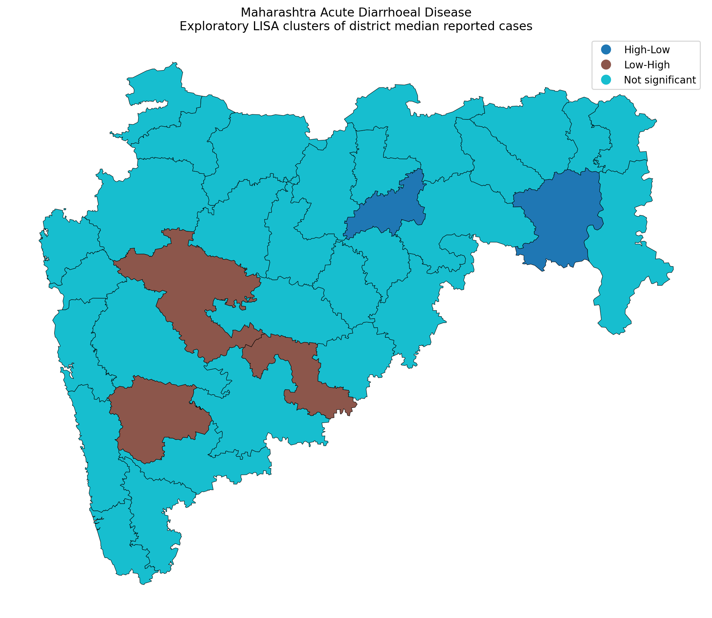
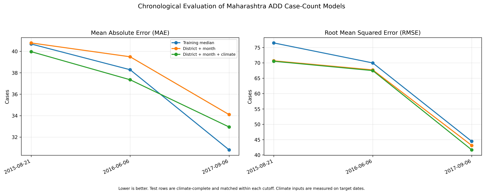

# Spatial Analytics Engine for Disease Outbreaks
## GIS-Based Spatio-Temporal Analysis and Exploratory Forecasting

**Project:** Spatial Analytics Engine for Disease Outbreaks
**Research focus:** Spatial epidemiology, temporal analysis, and exploratory forecasting
**Study area:** Maharashtra, India, with selected analyses of other Indian states
**Dataset period:** 2009–2022
**Supervisor:** Prof. Pabitra Mitra, IIT Kharagpur

---

## Abstract

This project develops a geographic information system (GIS) for visualizing
disease outbreak locations, analyzing spatial footprints, and exploring
spatio-temporal forecasting methods. The application combines an interactive
web interface, geospatial processing, a Python data-engineering pipeline, and
a FastAPI prediction service.

The research component investigates recorded Acute Diarrhoeal Disease (ADD)
cases in Maharashtra using district-level spatial summaries, temporal
visualizations, spatial autocorrelation analysis, period-wise comparisons,
and exploratory case-count prediction experiments.

The prepared Maharashtra ADD analysis contains 445 records. Reporting
coverage varies substantially across the study period, with 178 records in
2009–2013, 225 in 2014–2018, and 42 in 2019–2022. Among 15 districts meeting
the minimum observation requirement in both of the first two periods, eight
showed an increase and seven showed a decrease in median recorded cases.
Neither the Wilcoxon signed-rank test nor the sign test identified a
statistically significant directional shift. Global Moran's I analysis also
did not identify statistically significant spatial autocorrelation in
district-level median cases.

Exploratory forecasting experiments compared a training-median baseline,
district-and-month features, and district, month, and climate features across
three chronological cutoffs. Climate features consistently reduced RMSE
relative to the district-and-month model, but the models did not consistently
outperform the median baseline on mean absolute error. Since climate
measurements were taken from the target dates, these experiments should be
interpreted as retrospective case-count prediction, not validated operational
forecasting.

The project demonstrates an integrated GIS and analytical workflow while
highlighting the importance of reporting coverage, evaluation design, and
careful interpretation of sparse epidemiological data.

**Keywords:** GIS, spatial epidemiology, outbreak mapping, spatio-temporal
analysis, Moran's I, Random Forest, climate features, disease surveillance.

---

## 1. Introduction

Disease surveillance data can help researchers understand where cases are
recorded, how reported counts vary over time, and whether spatial patterns
warrant further investigation. However, surveillance records are often
irregular, incomplete, and affected by changes in reporting practices.
Analytical systems must therefore communicate both observed patterns and
uncertainty.

This project combines an interactive GIS application with an analytical
workflow for investigating recorded outbreak data. The engineering component
supports geographic visualization and exploratory prediction, while the
research component examines whether the available records support meaningful
spatial, temporal, and predictive conclusions.

### 1.1 Problem statement

A useful outbreak-analysis system must do more than display case locations.
It should support spatial footprint estimation, temporal exploration,
structured data processing, and evaluation of predictive methods against
simple baselines.

At the same time, sparse and irregular surveillance data create important
limitations. An apparent increase in recorded cases may reflect changing
reporting coverage rather than a genuine increase in disease incidence.
Similarly, a model that fits historical observations does not necessarily
predict future outbreak expansion accurately.

### 1.2 Objectives

1. Develop an interactive GIS interface for visualizing outbreak locations
   and their geographic footprint.
2. Implement spatial processing and data-export functionality.
3. Build a data-engineering and API pipeline for exploratory prediction.
4. Analyze district-level and monthly patterns in Maharashtra ADD records.
5. Examine spatial autocorrelation using Global Moran's I and local spatial
   statistics.
6. Compare exploratory case-count models with a simple training-median
   baseline using chronological evaluation.
7. Document data-quality issues, uncertainty, and limitations affecting
   interpretation.

---

## 2. System Architecture and Implementation

### 2.1 Interactive GIS frontend

The frontend uses HTML, JavaScript, Leaflet.js, and OpenStreetMap tiles to
display geographic locations and outbreak boundaries.

The principal capabilities include:

- Interactive placement and management of case-coordinate points.
- Convex-hull computation using the Monotone Chain algorithm.
- Geographic area estimation using Turf.js.
- Timeline controls for exploring outbreak scenarios.
- CSV export of coordinate data.
- Local persistence of interactive data using browser local storage.
- Historical district-level visualization using prepared summaries and
  district boundaries.

The convex hull represents the smallest convex polygon enclosing the
provided points. It is a geometric footprint, not a probability distribution
or a validated estimate of the actual area affected by disease transmission.

### 2.2 Data-engineering pipeline

The Python data-engineering workflow processes coordinate-based observations
into daily features, including case counts, centroids, and geographic spread
summaries.

Great-circle distances can be calculated using the Haversine formula to
estimate distances between geographic coordinates. These features provide
inputs for exploratory spatial and temporal analysis.

The interpretation of daily aggregates depends on the meaning and timing of
the input records. Synthetic or manually entered points must not be treated
as observed epidemiological surveillance data.

### 2.3 Prediction backend

The prediction service is implemented using FastAPI and exposes a prediction
endpoint for frontend requests.

The implemented forecasting components include:

- Polynomial trend extrapolation for spatial drift.
- A Susceptible-Infected-Recovered (SIR) compartmental model.
- Numerical parameter fitting against cumulative case curves.
- A heuristic that combines projected spatial radius with the fitted
  epidemiological component.
- A frontend overlay showing the projected expansion zone.

The SIR model uses susceptible, infected, and recovered compartments and
differential equations to represent a simplified transmission process.
Its parameters and outputs depend on the validity of the input time series,
initial conditions, and population assumptions.

The current spatial projection is a heuristic combination of trend
extrapolation and the fitted SIR component. It should not be described as a
validated estimate of future geographic spread without independent spatial
forecast evaluation.

### 2.4 Deployment

The frontend is deployed on Vercel and the FastAPI backend is hosted on
Render. This separates the interactive user interface from the prediction
service.

Live demo: https://outbreak-spatial-mapper.vercel.app/

Repository: https://github.com/Vya234/outbreak-spatial-mapper

---

## 3. Dataset and Data Preparation

### 3.1 Source and variables

The research uses an EpiClim dataset supplied for the project. The dataset
contains disease records spanning 2009–2022 and includes fields for disease,
cases, deaths, reporting week, date components, state, district, coordinates,
and environmental variables.

The original fields include:

- Disease and case counts.
- Death counts.
- State and district names.
- Day, month, and year.
- Latitude and longitude.
- Precipitation (`preci`).
- Leaf Area Index (`LAI`).
- Temperature (`Temp`).
- An index-like column named `Unnamed: 0`.

The Maharashtra ADD spatial-temporal analysis uses 445 prepared records.
Other analyses use different disease and state subsets; their sample sizes
must be reported separately.

### 3.2 Data-quality assessment

The broader dataset contains 8,985 rows. The initial audit identified the
following missing-value proportions:

| Variable | Missing |
|---|---:|
| Deaths | 71.6% |
| Precipitation | 1.5% |
| Leaf Area Index | 24.4% |
| Temperature | 10.4% |

An exact-duplicate audit identified 10 duplicate groups involving 20 rows
when the index-like `Unnamed: 0` field was excluded from comparison. These
groups included eight Acute Diarrhoeal Disease groups, one Dengue group, and
one Malaria group.

Potential duplicate records require source-level interpretation. Repeated
entries may reflect duplicated ingestion, repeated bulletins, or separate
reports. Therefore, the audit does not automatically justify deleting
records from the source dataset.

The stored outbreak-week field matched the ISO calendar week for 3,631 of
8,985 records (40.4%). This discrepancy does not establish that the stored
week is incorrect: it may represent a reporting or bulletin week. The field
should not be overwritten without a documented definition.

### 3.3 Irregular sampling

The Maharashtra ADD observations are irregularly sampled. Dates do not
represent a complete daily or weekly series, and districts have different
numbers of observations.

Consequently:

- Missing dates must not automatically be interpreted as zero cases.
- A previous recorded observation is not necessarily a one-week lag.
- Comparisons should disclose observation counts and reporting coverage.
- Forecasting evaluations must preserve chronological order.
- Claims about incidence require appropriate population denominators and
  information about surveillance coverage.

### 3.4 External record validation

A subset of records was checked against manually inspected NCDC/IDSP weekly
bulletin text. The validation file contains 13 selected records marked
`MATCH`.

This establishes agreement for those checked entries only. It does not
establish that every row in the complete dataset is correct or that the
dataset is free from duplication.

---

## 4. Spatio-Temporal Analysis of Maharashtra ADD

### 4.1 Study subset and period grouping

The analysis uses 445 prepared Maharashtra ADD records grouped into three
periods:

| Period | Districts observed | Records |
|---|---:|---:|
| 2009–2013 | 29 | 178 |
| 2014–2018 | 32 | 225 |
| 2019–2022 | 18 | 42 |

District medians were calculated from available observations. Districts
without observations in a period were left unreported rather than assigned
zero.

The district labels Sholapur and Solapur were normalized for spatial
comparison. The raw source labels should remain preserved in the original
data.

### 4.2 Period-wise district comparison

A district was included in a pairwise comparison only if it had at least
five observations in both periods. This practical threshold reduces
comparisons based on extremely small samples but does not guarantee
statistical reliability.

Fifteen districts met this criterion for 2009–2013 versus 2014–2018:

- Eight districts had higher median recorded cases.
- Seven districts had lower median recorded cases.
- The median district-level change was +6 cases.
- The mean district-level change was -4.97 cases.

Examples of observed changes include:

| District | Earlier median | Later median | Change |
|---|---:|---:|---:|
| Gadchiroli | 25 | 54 | +29 |
| Nanded | 21.5 | 39 | +17.5 |
| Sangli | 95 | 47 | -48 |
| Pune | 131 | 36 | -95 |

The mean change was influenced by large decreases in some districts. These
statistics describe recorded counts, not population-adjusted incidence.

### 4.3 Statistical tests

For the 15 districts comparable across 2009–2013 and 2014–2018:

| Test | Statistic | p-value |
|---|---:|---:|
| Wilcoxon signed-rank test | 51.5 | 0.629 |
| Two-sided sign test | — | 1.000 |

Neither test provided evidence of a consistent directional shift at the
conventional 5% significance level.

This does not prove that disease incidence remained stable. The comparison
is exploratory and is affected by sparse observations, changing reporting
coverage, and the practical inclusion threshold.

Only Kolhapur met the minimum observation requirement in both 2014–2018 and
2019–2022. Therefore, a meaningful statewide comparison involving the final
period was not possible under this criterion.

### 4.4 Monthly timeline and reporting coverage

The monthly timeline covers July 2009 to June 2022 and reindexes the data to
a complete calendar of 156 months.

- Months without observations: 40.
- Observed months with fewer than three records: 55.
- The largest observed monthly median was 607 cases in April 2020.
- That value came from a single record from one district.

The April 2020 value must not be interpreted as a statewide outbreak peak.
The monthly visualization presents reporting counts, districts reporting,
and median recorded cases. Months with limited reporting are explicitly
identified, and missing months are retained as missing rather than set to
zero.

The case-summary panel uses a logarithmic vertical axis. Its values should
therefore be interpreted on a log scale.

The timeline describes the available records; it does not establish
continuous disease incidence, a causal trend, or reliable seasonality.

---

## 5. Spatial Autocorrelation Analysis

### 5.1 Method

Global Moran's I was used to assess whether district-level case summaries
exhibited spatial autocorrelation under the selected district-neighbour
definition. Local Indicators of Spatial Association (LISA) were also used
to explore local spatial patterns.

The analysis normalized Sholapur to Solapur to align the data with the
district boundary layer. The matched spatial analysis contained 34 districts.

### 5.2 Global Moran's I results

| District summary | Moran's I | Permutation p-value |
|---|---:|---:|
| Median cases | -0.0050 | 0.3551 |
| Mean cases | 0.1048 | 0.1226 |
| Maximum cases | 0.0018 | 0.3585 |

None of the three global statistics was significant at the 5% level.

A robustness analysis varying the minimum number of observations per
district also produced non-significant global Moran's I results. The number
of included districts decreased as the threshold increased, reducing the
coverage of the analysis.

### 5.3 Local patterns

The median-case LISA classification contained 29 districts labelled not
significant, three Low-High districts, and two High-Low districts.

These local classifications are exploratory and should be interpreted
alongside the global results, sample sizes, spatial weights, and multiple
testing considerations. They do not independently establish disease
transmission between neighbouring districts.

### 5.4 Interpretation

The current analysis did not detect statistically significant global
spatial autocorrelation in the selected district-level summaries.

This is not evidence that geographic factors are irrelevant. District
summaries, sparse observations, reporting differences, and the chosen
spatial-neighbour definition can all influence the results.

---

## 6. Exploratory Case-Count Prediction

### 6.1 Research question

The predictive experiments investigate whether district identity, calendar
month, and climate variables help predict recorded case counts compared
with a simple baseline.

These experiments are separate from the frontend's heuristic prediction
of geographic expansion. Good performance on case-count prediction would
not, by itself, validate a forecast of future outbreak boundaries.

### 6.2 Models

Three models were compared:

1. **Training-median baseline:** predicts the median case count in the
   training data.
2. **District + month:** a Random Forest model using district identity and
   calendar month.
3. **District + month + climate:** a Random Forest model adding temperature,
   precipitation, and Leaf Area Index.

The Random Forest experiments used 300 trees, a minimum leaf size of five,
and a fixed random seed. District identity was one-hot encoded. Climate
experiments used rows with complete climate measurements.

### 6.3 Chronological evaluation

The fair model comparison used chronological cutoffs and matched
climate-complete test rows for all three models at each cutoff.

| Cutoff | Model | Training rows | Test rows | MAE | RMSE |
|---|---|---:|---:|---:|---:|
| 2015-08-21 | Training median | 172 | 108 | 40.681 | 76.476 |
| 2015-08-21 | District + month | 172 | 108 | 40.780 | 70.657 |
| 2015-08-21 | District + month + climate | 172 | 108 | 39.967 | 70.515 |
| 2016-06-06 | Training median | 200 | 80 | 38.281 | 69.964 |
| 2016-06-06 | District + month | 200 | 80 | 39.489 | 67.696 |
| 2016-06-06 | District + month + climate | 200 | 80 | 37.346 | 67.472 |
| 2017-09-06 | Training median | 230 | 50 | 30.810 | 44.437 |
| 2017-09-06 | District + month | 230 | 50 | 34.099 | 43.102 |
| 2017-09-06 | District + month + climate | 230 | 50 | 32.943 | 41.663 |

MAE is mean absolute error; RMSE is root mean squared error. Lower values
indicate better performance.

### 6.4 Results

Across all three cutoffs, adding climate features reduced RMSE relative to
the district-and-month model. The climate model also reduced MAE relative
to that model at each cutoff.

Relative to the training-median baseline, the climate model achieved:

| Cutoff | MAE improvement | RMSE improvement |
|---|---:|---:|
| 2015-08-21 | 1.75% | 7.80% |
| 2016-06-06 | 2.44% | 3.56% |
| 2017-09-06 | -6.92% | 6.24% |

Positive improvement means lower error than the baseline; negative
improvement means worse performance.

Thus, the climate model consistently improved RMSE over the median baseline
in these experiments but did not consistently improve MAE. The findings
suggest that climate variables may help reduce larger prediction errors,
but the evidence does not establish a uniformly superior predictive model.

The test windows overlap across cutoffs, so these results should not be
treated as three independent replications.

### 6.5 Important forecasting limitation

The climate variables were measured on the same dates as the target case
counts. Consequently, the experiment is a retrospective prediction exercise
using contemporaneous climate data. In a genuine future forecast, these
inputs would need to be available at prediction time, for example through
lagged climate observations or weather forecasts.

The evaluation predicts recorded case counts at observed dates. It does not
validate future geographic spread, the SIR-derived radius multiplier, or the
accuracy of the frontend's predicted expansion boundary.

---

## 7. Discussion

The project integrates geospatial software engineering with exploratory
epidemiological analysis. Its primary strengths are the interactive spatial
interface, modular backend, reproducible analytical scripts, explicit
reporting-coverage analysis, and comparison of predictive models against a
simple baseline.

The research results also demonstrate why data limitations must be part of
the analysis rather than an afterthought.

First, uneven reporting makes it difficult to interpret changes in recorded
cases as changes in disease incidence. Second, global spatial autocorrelation
was not statistically significant for the selected district summaries.
Third, climate features improved RMSE consistently across the tested
chronological cutoffs, but the models did not consistently outperform the
median baseline on MAE.

These findings are not failures of the project. They identify which
conclusions are supported by the available data and where stronger
validation is needed.

---

## 8. Limitations

1. **Reporting coverage:** Observation counts vary across districts, years,
   and months.
2. **Irregular sampling:** The data do not form a complete daily or weekly
   surveillance series.
3. **Missing values:** Death and climate variables have missing observations.
4. **Case-count interpretation:** Recorded counts are not population-adjusted
   incidence rates.
5. **Duplicate ambiguity:** Repeated entries require source-level
   interpretation before removal.
6. **Limited external validation:** Only a small selected subset was checked
   against IDSP bulletin text.
7. **Spatial aggregation:** District-level summaries can conceal local
   variation within districts.
8. **Prediction inputs:** Contemporaneous climate measurements limit the
   operational interpretation of the retrospective experiment.
9. **Forecast validation:** The geographic expansion heuristic has not yet
   been independently validated against held-out future outbreak boundaries.
10. **Uncertainty:** Fixed radius adjustments and limited empirical
    uncertainty calibration do not establish statistically calibrated
    prediction intervals.
11. **Generalizability:** Results for Maharashtra ADD cannot automatically
    be generalized to other diseases or states.

---

## 9. Future Work

### 9.1 Strengthen data validation

- Document the source definitions of reporting week, case counts, and
  repeated records.
- Preserve original records and maintain an auditable preprocessing log.
- Expand bulletin validation using a defined sampling strategy.
- Investigate district-name and geographic-boundary mismatches.

### 9.2 Improve temporal analysis

- Continue displaying the number of reporting districts alongside case
  summaries.
- Explore models appropriate for irregular observations.
- Assess whether the available coverage supports seasonal analysis before
  making seasonal claims.
- Separate reporting-process changes from possible epidemiological changes.

### 9.3 Improve forecasting evaluation

- Evaluate models using strictly chronological splits.
- Compare against appropriate baselines on identical test observations.
- Use lagged or genuinely forecast-available climate inputs.
- Report errors by disease, district, forecast horizon, and coverage level.
- Keep case-count evaluation separate from spatial expansion evaluation.
- Validate geographic forecasts against held-out future observations before
  claiming operational usefulness.
- Estimate uncertainty empirically and test its calibration.

### 9.4 Spatial and epidemiological extensions

- Investigate spatial and spatio-temporal models if data density permits.
- Examine alternative spatial weights and sensitivity to district coverage.
- Explore prediction of newly affected regions only after defining a
  reliable event-level target and validation protocol.
- Consider population denominators and additional covariates where
  appropriate data are available.

---

## 10. Conclusion

This project presents an integrated GIS application and an exploratory
research workflow for disease-outbreak analysis. It combines interactive
geographic visualization, convex-hull-based spatial footprints, data
processing, a prediction API, district-level spatio-temporal analysis,
spatial autocorrelation tests, and chronological case-count model
comparisons.

The Maharashtra ADD analysis did not detect a statistically significant
directional shift between the first two comparison periods or significant
global spatial autocorrelation in the selected district summaries.
Reporting coverage was too uneven to support a meaningful statewide
comparison involving 2019–2022 under the chosen observation threshold.

In predictive experiments, climate features consistently reduced RMSE
relative to a district-and-month Random Forest model. However, performance
relative to the training-median baseline was mixed across MAE and RMSE.
Because the climate features were contemporaneous with the target dates,
the results remain retrospective rather than a validated operational
forecast.

The central contribution is an integrated and reproducible analytical
workflow that makes spatial patterns and reporting limitations visible
while establishing a clear foundation for more rigorous spatio-temporal
forecasting research.

---

## Appendix A. Reproducibility and Supporting Outputs

Key analysis outputs include:

- `research_outputs/mh_add_spatiotemporal_findings.md`
- `research_outputs/mh_add_spatiotemporal_maps.png`
- `research_outputs/mh_add_spatiotemporal_summary.csv`
- `research_outputs/mh_add_period_change_uncertainty.csv`
- `research_outputs/mh_add_reporting_aware_timeline.png`
- `research_outputs/mh_add_reporting_aware_monthly.csv`
- `research_outputs/mh_add_moran_summary_robustness.csv`
- `research_outputs/mh_add_fair_model_comparison.csv`
- `research_outputs/rolling_origin_mh_add_fair_results.csv`
- `research_outputs/idsp_validation.csv`

Exact commands, software versions, dependency versions, and dataset
definitions should be recorded before final submission. All reported
numbers should be regenerated from the final scripts and checked against
the saved outputs.

## Appendix B. Figures to Include in the Final BTP

1. System architecture diagram: frontend, data pipeline, API, and model.
2. Screenshot of the interactive GIS application.
3. Maharashtra district median maps for the three study periods.
4. Monthly reporting-aware timeline.
5. Global and local spatial-autocorrelation map.
6. Chronological model comparison figure showing MAE and RMSE.
7. Example of a forecast expansion overlay, explicitly labelled as an
   exploratory model output rather than a validated prediction.

---

## 11. Key Research Figures

### 11.1 District-level spatio-temporal comparison

**Figure 1.** District-level median recorded ADD cases across three study
periods. Districts without observations are not assigned zero. Differences
should be interpreted in light of unequal reporting coverage.

### 11.2 Monthly timeline and reporting coverage

**Figure 2.** Monthly recorded observations, reporting districts, and median
recorded cases. Sparse months are flagged; missing months are not treated as
zero incidence.

### 11.3 Local spatial autocorrelation

**Figure 3.** Local spatial association classifications for district-level
median cases. Global Moran's I was not statistically significant
(I = -0.0050, permutation p = 0.3551).

### 11.4 Chronological model comparison

**Figure 4.** MAE and RMSE across three chronological cutoffs. Lower values
indicate lower error. Climate measurements are contemporaneous with target
dates, so the evaluation does not establish future operational forecasting
performance.
